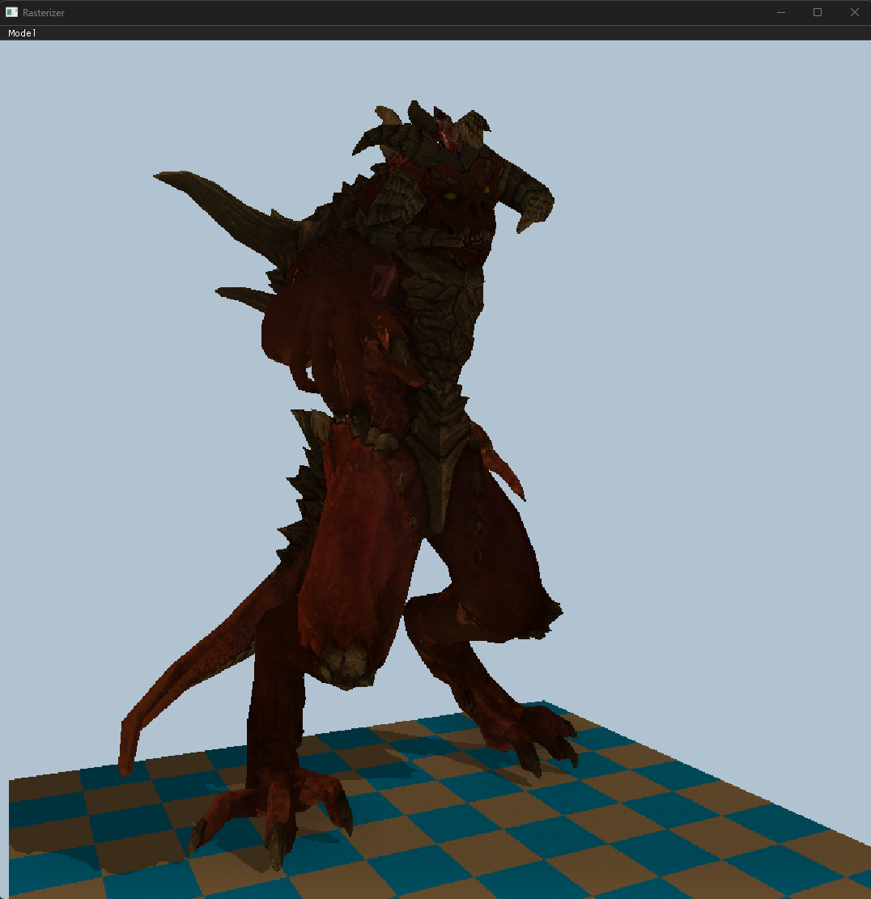
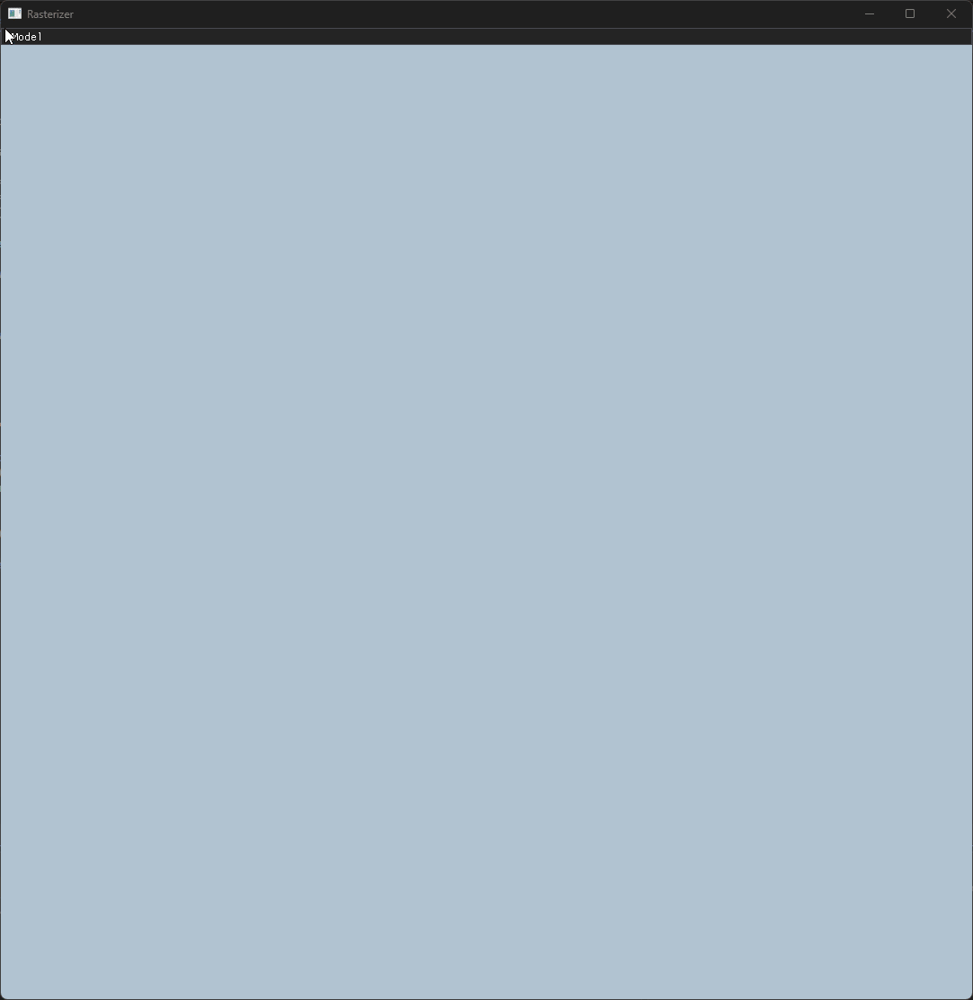

# CPU-Rasterizer

A CPU renderer written in C/C++, using SDL3 for realtime display. Built following the TinyRenderer project by Dmitry V. Sokolov.

## Overview

This project is a simulation of the rendering process done by graphics APIs such as OpenGL, Vulkan, and DirectX written in raw C/C++. All pixels are manually drawn to a framebuffer, using a custom Shader class, then rendered with SDL3 in realtime.

## Purpose
The purpose of this project is to gain a more thorough understanding of the rendering process used by modern graphics APIs. Rendering steps that would be handled automatically, such as clipping and perspective division, are handled manually in order to better understand the process.
Additionally, I made use of the SDL3 library in order to display the rendering process in realtime.

## Usage
To perform a render of a model, open the "Model" dropdown at the top of the window, and select which models to render from the dropdown. Once you have selected all the models you wish to render, press the render button to begin the render process. The "Model" button will be greyed out and disabled until the render has been fully completed.